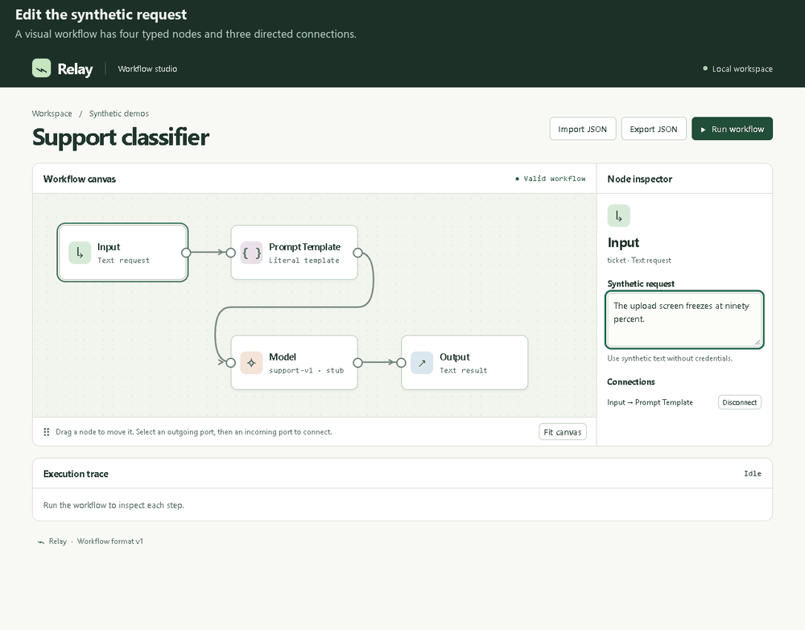

# Relay — Open-Source Visual AI Agent Builder

Relay is a local visual editor for a four-step text workflow. The synthetic support demo connects **Input → Prompt Template → Model → Output**. You can edit the request and template, move nodes, reconnect ports, and replay exported JSON from the command line. The default model is a deterministic keyword stub. An opt-in adapter can run the same workflow on a local Ollama model.

## Run the editor

Use Node.js **22.19.0**, the tested version. The application and core tests use Node built-ins and native browser APIs. Run these commands from the directory containing `package.json`.

```shell
node server.mjs
```

Open [the local editor](http://127.0.0.1:4316). Use the literal address shown. Port 4316 must be free. Stop the server with Ctrl+C. The server does not persist edits. Export before refreshing or closing the page.

## Editor walkthrough



## Two-minute demo

1. Select **Run workflow**. The duplicated-charge fixture produces `billing`. The trace displays the input, rendered prompt, model response and final text in traversal order.
2. Select **Input**, change the request to `My login is locked.`, and run again. The stub returns `account`. Drag the card and rerun to see the same trace.
3. In the Input inspector, select **Disconnect**. The canvas shows a validation error and disables Run. Click Input’s right port and then Prompt Template’s left port to reconnect them. Ports and node selection also support Tab and Enter.
4. Select **Export JSON**. Copy the displayed JSON or use **Download JSON**. Select **Import JSON** to reopen a valid workflow file. The editor checks it before replacing the current graph.
5. Select **Model**, change **Stub behavior** to **Simulate provider failure**, and run. The trace identifies Model as failed and Output as skipped. Set the mode back to **Classify request** to resume.

## Headless replay and tests

```shell
node cli.mjs examples/support.json
npm test
```

For an exported file, use `node cli.mjs path/to/relay-workflow.json`. The CLI prints the same result object the editor receives. Exit codes are 0 for success, 1 for a node failure, and 2 for a file or validation error. Core and request-handler tests run offline.

## Optional browser verification

With Chrome installed, install the test driver once in the source directory. Its version is checked at startup. On a machine with the package already installed, set `RELAY_BROWSER_MODULES` to its Node resolution root instead.

```shell
npm install --no-save --package-lock=false --ignore-scripts playwright-core@1.63.0
npm run test:browser
```

The default check starts a server on an ephemeral loopback port, drives Chrome, saves the exported file, invokes the actual CLI on that file, and imports it again. For environments with restricted sockets, `node tests/browser.mjs --in-process` drives Chrome through the same HTTP handler using Playwright routing. In this mode the test verifies the browser's download event, suggested filename and serialized payload, and writes those bytes to a temporary file for replay. Add `--check-download` to also require Chrome's native download manager to save the file. Desktop and 390-pixel layouts are exercised. The headless test cleans up its temporary directory and closes the browser.

On Windows, if Chrome cancels the native save, try setting both TEMP and TMP to a writable local scratch folder for that test process. This resolved the issue in the verified run.

## Local Ollama adapter (opt-in)

The Model node can use `provider: "ollama"`, `model: "qwen3:4b"`, `mode: "classify"` instead of the stub. See [examples/support-ollama.json](examples/support-ollama.json). Calls stay on this computer. Nothing is sent unless the server or CLI process was started with the opt-in variable.

1. Start Ollama and pull the model once: `ollama serve`, then `ollama pull qwen3:4b`.
2. Check the integration: `npm run smoke:ollama`. Running this script is the opt-in; it enables the adapter only for the CLI processes it starts. It checks one constrained call per run, the label, the bounds and the exit code. It is not a quality evaluation.
3. To use it in the editor, start the server with the variable set. PowerShell: `$env:RELAY_ENABLE_OLLAMA='1'; node server.mjs`. POSIX shells: `RELAY_ENABLE_OLLAMA=1 node server.mjs`. In the Model inspector, choose **Ollama · qwen3:4b**.

| Variable | Default | Effect |
| --- | --- | --- |
| `RELAY_ENABLE_OLLAMA` | unset | Must be `1`; otherwise Model fails with "Ollama is disabled" and no request is made |
| `RELAY_OLLAMA_URL` | `http://127.0.0.1:11434` | Plain `http` origin on `127.0.0.1`, `localhost` or `[::1]` only; anything else is refused |
| `RELAY_OLLAMA_MAX_CALLS` | `50` | Calls allowed per server or CLI process; later runs fail Model without a request until restart |

An unset origin uses the default. An explicitly empty origin is refused. Each CLI process starts with a fresh call budget, so an exhausted editor server can refuse JSON that succeeds in the CLI. Compare traces with matching available budgets and provider settings.

The adapter sends the rendered prompt as the user message with a fixed system instruction listing the four labels, and constrains the reply to `billing`, `account`, `technical` or `other` with Ollama's JSON-schema `format`. Temperature is 0 with a fixed seed; repeated runs are expected but not guaranteed to match. A timeout signals cancellation to the HTTP transport. The slot becomes available when the adapter's promise settles. Unreachable server, missing model, HTTP errors, unreadable or unrecognized replies fail Model with a specific message and skip Output.

## Workflow format and execution

See [examples/support.json](examples/support.json) for the complete v1 document. Node IDs must be unique, start with a letter and contain up to 40 ASCII letters, digits, underscores or hyphens. Each node has `id`, `type`, `config`, and optional `position` with numeric x/y from 0 through 2400. Each edge contains `from` and `to` IDs. Root, node, config, edge and position fields use exact allowlists.

| Node | Configuration | Text behavior |
| --- | --- | --- |
| Input | `text` | Provides one nonblank synthetic request |
| Prompt Template | `template` | Substitutes the input literally at exactly one `{{input}}`; other braces are invalid |
| Model | `provider: "local-stub"`, `model: "support-v1"`, `mode: "classify"` or `"simulate-failure"`; or `provider: "ollama"`, `model: "qwen3:4b"`, `mode: "classify"` | Classifies the rendered prompt, or simulates a failure (stub only) |
| Output | Empty object | Passes through the successful model text |

The planner indexes IDs, checks edge endpoints and degrees, and follows outgoing edges from Input. It checks every visited type and requires all four nodes to be reachable. The executor consumes that ordered plan. Position, node array order and edge array order have no execution semantics. The UI imports the same validator as the server and CLI. The server, CLI and evaluation runner share the executor. The browser sends execution requests to the server.

| Boundary | Limit |
| --- | --- |
| Workflow file or POST body | 32 KiB of UTF-8 JSON |
| Input / template / rendered prompt | 2,048 / 1,024 / 3,072 UTF-16 code units |
| Model output | 128 UTF-16 code units, nonblank text |
| Work per run | Four nodes, one model call, no retries |
| Provider calls per process | At most 1 unsettled call. A run that finds a call still running (for example, one abandoned after a timeout) fails Model without calling the provider. |
| Time | 3 s body-read deadline. Stub: 2 s executor deadline, 750 ms maximum model wait. Ollama: 16 s executor deadline, 15 s maximum model wait. These are cooperative deadlines. The event loop can deliver cancellation slightly late. The editor waits up to 18 s for a response. |
| Ollama calls | Opt-in per process, loopback only, `RELAY_OLLAMA_MAX_CALLS` per process (default 50) |
| HTTP | IPv4 loopback only, exact Host, same-origin browser requests, fixed asset paths, JSON-only POST, up to 16 connections |

HTTP requests have separate ingress and execution budgets. The server also configures a 3 s header timeout and a 6 s HTTP request timeout. A failed step keeps its error, marks subsequent steps skipped, and returns a null final output. The run deadline is checked between nodes. The model timer signals cancellation and bounds the awaited result. The in-flight slot is released only when the provider's own promise settles, so a provider that ignores cancellation blocks later runs instead of stacking calls; one that never settles blocks them until restart. JavaScript timers cannot preempt blocking code. Ollama fetch receives the abort signal. Successful provider response bodies are capped at 65,536 bytes while reading.

## Scope and limitations

- The keyword classifier recognizes a fixed set of words. The local model is restricted to four labels. Both can return a plausible but incorrect label. The small synthetic evaluation below describes only the frozen cases.
- The process reads no provider credentials; the Ollama adapter needs none. The contract rejects credential fields, unknown provider settings, endpoint fields and tools. It rejects several recognizable credential patterns in IDs, in each text field, and in the rendered prompt, so a pattern split across the template and the input is also rejected before any call. Free text can still contain an unrecognizable secret. Use synthetic text only. Exported workflows and displayed traces contain plain text.
- The visual workspace supports one linear graph with four required node types. One workflow lives in the current tab. Saving JSON is explicit. The CLI reads just the file supplied by the operator.
- The local service is designed for one trusted user. Applications running on the same computer can invoke it. There is no per-user authentication or deployment configuration.
- The four-step path, four labels and trusted local workload define the scope. Production accuracy, multi-user isolation and deployment are outside this release.

## Measured synthetic results

The keyword baseline and qwen3:4b each classified **16 of 24** frozen held-out requests correctly (66.7%). Each method got six requests right that the other missed. The local model recovered more billing and technical paraphrases, while the keyword fallback correctly classified more general questions. There were zero invalid replies, execution failures or abstentions. Median executor latency was **0.063 ms** for the baseline and **142.874 ms** for Ollama on this workstation. No external API was called. Energy and dollar cost were unmeasured.

See [per-class results and example errors](docs/evaluation.md), [the frozen protocol](evaluation/PROTOCOL.md) and [per-case evidence](evidence/heldout.json).

To reproduce after installing the local model, run the following commands from the repository root in PowerShell. The commands print JSON. PowerShell 7 or a UTF-8 redirect can be used to save a separate run.

```powershell
$env:RELAY_ENABLE_OLLAMA='1'
node evaluation/run.mjs dev
node evaluation/run.mjs heldout
```

On POSIX shells prefix each invocation with `RELAY_ENABLE_OLLAMA=1`. Both splits use local inference. The default `npm test` suite does not require a model or network connection. After checkout and Node setup, the GitHub Actions verification step runs the tests and deterministic CLI demo in a separate Linux network namespace with a clean environment. A runtime check verifies namespace separation before either command runs.

[Architecture notes](docs/architecture.md) · [Environment, licenses and reuse decisions](docs/environment.md) · [MIT license](LICENSE)
